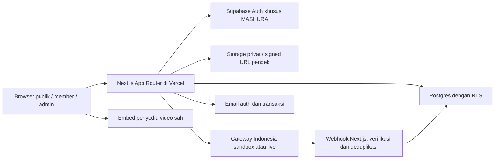

# Arsitektur teknis yang diusulkan

Status: rancangan Sprint 0, belum diimplementasikan. Acuan: [PRD §7](PRD.md), [database](database.md), [keamanan](security.md). Pilihan teknis di bawah dapat disesuaikan saat Sprint 1 tanpa memperluas fitur.

## Komponen dan batas kepercayaan



Next.js + TypeScript strict sebagai satu aplikasi modular, bukan microservices. Server Components untuk render katalog/member/admin; Client Components hanya untuk interaksi. Route Handlers menerima webhook, checkout dan download. Server Actions atau handler mutasi memvalidasi input, session dan capability per permintaan. Middleware hanya membantu navigasi, tidak menjadi pengaman tunggal.

Postgres adalah sumber kebenaran status order, entitlement dan ledger. Redirect browser bukan bukti pembayaran. Browser tidak boleh menulis nominal, role, payment status atau ledger. Gunakan Supabase SDK ber-session untuk operasi pengguna agar RLS tetap berlaku; client privileged server terpisah hanya untuk operasi terpercaya yang memerlukannya. Tidak ada service-role key dalam bundle browser.

## Struktur usulan Sprint 1 (belum dibuat)

```text
src/app/(store)/                beranda, kategori, pencarian, detail
src/app/(auth)/                 login, callback, claim
src/app/(member)/               koleksi, pesanan sendiri, materi
src/app/admin/                  dashboard dan navigasi mobile/desktop
src/app/api/checkout/            invoice satu SKU
src/app/api/payments/webhook/    verifikasi provider
src/app/api/invoices/            status terotorisasi
src/app/api/materials/           authorize lalu signed URL / proxy
src/components/                 UI bersama
src/lib/auth/                   session dan capability server
src/lib/supabase/               client browser/session/privileged terpisah
src/modules/catalog/            validasi publish, branding, promo dasar
src/modules/payments/           adapter gateway, state machine, rekonsiliasi
src/modules/access/             claim, grant, expiry, bundle
src/modules/finance/            ledger, refund, payout, CSV
supabase/migrations/            SQL versioned mulai Sprint 1
supabase/tests/                 RLS dan constraint
 tests/                         unit/integrasi/E2E (lokasi final saat scaffold)
```

Versi Next.js, Node LTS yang didukung Next/Vercel, Supabase SDK/CLI dan test runner dikunci saat scaffold setelah kompatibilitas diperiksa. Gunakan satu package manager (usulan npm) dan commit lockfile; `npm ci` untuk CI. Runtime cloud saat audit memiliki Node 24.19.0 tetapi itu bukan pin proyek. Belum ada dependency ditambahkan pada Sprint 0.

## Kontrak alur inti

1. **Katalog:** publik hanya menerima field aman produk `published`, kategori/galeri/FAQ yang sesuai. Prompt berbayar, link eksternal, body LMS dan path storage tidak dikirim dalam HTML/payload publik. Branding dinamis di database; invalidasi cache setelah update/publish.
2. **Checkout:** server baca harga dan aturan produk terbit, validasi nama/email/WA (normalisasi konservatif email, WA ke E.164), buat purchase group dan invoice dengan snapshot total IDR. Provider dipanggil memakai idempotency key yang stabil; timeout ditangani dengan lookup, bukan membuat charge tak terkendali. Perubahan harga setelah checkout tidak memengaruhi invoice.
3. **Invoice tamu:** akses melalui token acak berentropi tinggi, hash token tersimpan server; invoice number bukan credential. Respons hanya data minimum, tidak dapat membaca koleksi atau mengklaim email. Hindari token di log/referrer; rate limit dan masa berlaku. Member melihat invoice hanya miliknya.
4. **Payment:** verifikasi signature terhadap raw body dan verifikasi server-to-server sesuai provider. Cocokkan merchant, environment, external payment ID, invoice, IDR dan jumlah. Simpan event; kunci purchase group/order, cek transisi, terapkan paid + grant sumber + accrual komisi atomik dalam satu transaksi DB. Event yang gagal diproses tetap dapat di-retry; ACK sukses hanya sesudah durable record. Jika pekerjaan perlu async, gunakan tabel kerja DB dan retry terotorisasi; bukan proses background dalam request Vercel yang sudah selesai.
5. **Retry/konkurensi:** invoice baru memiliki ID/payment baru, `retry_of_order_id` dan purchase group sama. Invoice lama tidak direaktivasi oleh invoice baru. Satu accepted order per group; paid ganda/paid pada invoice expired masuk rekonsiliasi dengan uang tetap tercatat, tanpa akses atau komisi otomatis ganda. Kebijakan resolusi provider/ops dikonfirmasi sebelum Sprint 3.
6. **Claim:** pembayaran tamu membuat grant belum terikat akun. Sesudah session Supabase menunjukkan email terverifikasi yang sama dengan snapshot email, server mengikat order/grant dalam transaksi. Jangan mempercayai user_id/email kiriman browser. Salah ketik email hanya dibetulkan lewat prosedur manual terverifikasi dan audit.
7. **Akses:** cek session, grant efektif, produk, expiry, revoked dan status materi setiap permintaan. Buat signed URL pendek (usulan 60 detik) hanya setelah pemeriksaan. Signed URL dapat digunakan sampai TTL habis sesudah revoke; proxy download dipilih bila dibutuhkan pencabutan segera. Materi baru tidak butuh pembelian ulang bila grant masih aktif.
8. **Email:** kirim sesudah commit; tabel outbox mencegah notifikasi hilang saat request gagal. Retry pakai unique key jenis pesan/order/penerima; provider kegagalan email tidak membatalkan pembayaran. Resend login terbatasi dan tidak mengungkap keberadaan akun.
9. **Finance:** dashboard Firdi dan Vini query sumber ledger yang sama. Refund tidak menghapus transaksi/grant/ledger. Penyesuaian ledger dan pencabutan per sumber sesuai kebijakan saat pembelian. Export dibatasi role dan formula CSV dinetralkan.

## Routing dan pengalaman

Usulan URL: `/`, `/kategori/[slug]`, `/cari`, `/produk/[slug]`, `/checkout/[slug]`, `/invoice/[token]`, `/masuk`, `/auth/callback`, `/koleksi`, `/koleksi/[productId]`, `/pesanan`, `/admin/{pesanan,produk,member,keuangan,pengaturan}`. Tidak ada route atau state cart. CTA menjadi Buka Produk bagi pemilik aktif. Detail akses expired/failed/pending dibuat jelas. Navigasi admin HP mengikuti lima tab PRD; desktop sidebar dengan modul sama. Loading/empty/error state, label form, fokus keyboard dan kontrol sentuh diuji.

## Lingkungan dan deployment (rencana saja)

| Lingkungan | Tujuan | Data dan kredensial |
|---|---|---|
| Lokal/test | Supabase lokal atau resource development MASHURA yang disetujui | Fixture sintetis, gateway sandbox, email test |
| Preview/staging Vercel | Uji integrasi dan penerimaan | Backend staging terpisah dari production; sandbox; preview dibatasi akses |
| Production Vercel | Transaksi komersial | Supabase MASHURA production, live key hanya production, domain disetujui |

Semua resource teknis menggunakan identitas `mashura` dengan penanda lingkungan bila perlu, tanpa koneksi BADAI. Preview tidak terhubung database/live gateway produksi. Nama/owner/resource ID diverifikasi sebelum provisioning; jumlah project dan biaya disetujui dulu. Pilih paket Vercel yang mengizinkan penggunaan komersial (PRD menyebut Pro); verifikasi ketentuan aktual sebelum pembelian. Pantau batas Supabase, backup, bandwidth dan video provider.

Usulan variabel: `NEXT_PUBLIC_SUPABASE_URL`, `NEXT_PUBLIC_SUPABASE_PUBLISHABLE_KEY` (anon key lama bila SDK mengharuskan), `SUPABASE_SECRET_KEY`/service-role hanya server, `APP_ORIGIN`, `PAYMENT_ENV`, credential API/webhook gateway dan credential email sesuai provider. Hanya URL/publishable key boleh publik. Tidak membuat nilai dummy, .env berisi rahasia, koneksi atau binding sekarang. Auth redirect allowlist dan webhook endpoint khusus tiap lingkungan; preview tidak menerima live webhook.

CI Sprint 1: frozen install → lint → typecheck → unit/integrasi → build; tambah SQL/RLS dan E2E sesuai modul. Migration ditinjau, diuji lokal/staging, diterapkan dengan langkah eksplisit sebelum deploy yang bergantung padanya. Perubahan schema kompatibel ke belakang; rollback aplikasi tidak boleh menghapus histori keuangan. Tidak ada deploy pada Sprint 0.
