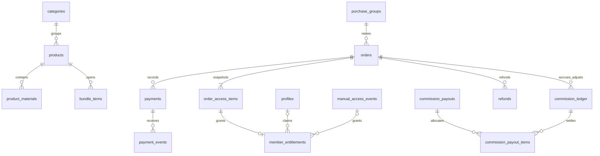

# Rancangan database dan integritas transaksi

> Dokumen baseline Sprint 0. Status implementasi dan hasil validasi terkini: [laporan Sprint 1](sprint-1-report.md). Bagian yang menyebut belum ada kode/tes menggambarkan kondisi saat audit Sprint 0.

Status: spesifikasi Sprint 0, **bukan migration SQL dan belum dijalankan**. Semua entitas berada di Supabase MASHURA tersendiri. PostgreSQL UUID sebagai PK kecuali singleton; timestamp `timestamptz` UTC; tampilan WIB; uang `bigint` rupiah bulat (`currency = IDR`), bukan float. Enum/check constraint dan index final diterjemahkan ke migration versioned pada sprint terkait. RLS semua tabel Data API; tabel internal di schema non-exposed ditambah pembatasan privilege.

## Kamus data

Semua FK harus memiliki aksi penghapusan eksplisit. Data transaksi/audit tidak di-cascade delete ketika produk, profil atau akun dinonaktifkan. `created_at`, dan `updated_at` hanya bila entitas dapat diubah; histori immutable memiliki waktu pencatatan dan aktor.

| Tabel | Kolom inti dan relasi | Constraint / indeks penting |
|---|---|---|
| `store_settings` | id singleton, display_name, logo_asset_id, favicon_asset_id, accent_color, description, support_contact, general_faq, legal_text, public_page_settings | Satu row; hanya field publik aman diekspos; validasi warna/URL/teks |
| `store_banners` | id, image_asset_id, title, target_url, position, is_active | Urutan deterministik; tautan aman |
| `profiles` | id → auth.users, display_name, whatsapp | PK user ID; email verifikasi sumbernya Auth, bukan profile |
| `admin_roles` | user_id → auth.users, role business_admin/technical_admin, granted_by, granted_at, revoked_at | Satu role aktif per user/role (partial unique); tidak dapat ditulis user sendiri |
| `categories` | id, name, slug, position, is_active | Unique slug; FK product dibatasi saat masih dipakai |
| `products` | id, sku, slug, category_id, title, type, status draft/published/inactive, price_idr, summary, description, benefits, included_items, requirements, faq, terms, access_kind, access_days, is_featured, featured_position, published_at | Unique sku/slug; price >= 0; access_kind available/fixed; fixed hanya 30/365; enum type enam jenis PRD |
| `product_price_history` | id, product_id, old_price, new_price, actor_id, changed_at, promotion_reason, valid_from/to, reference_evidence | Append-only; bukti diskon untuk harga coret, tidak boleh fabrikasi |
| `product_media` | id, product_id, bucket, object_path, kind cover/gallery, alt_text, position | Media katalog terpisah file berbayar; unique bucket/path |
| `product_materials` | id, product_id, parent_id nullable, type chapter/lesson/file/prompt/external_link, title, body, video_url, private_asset_id, external_url, position, status draft/published/archived, version | Parent di produk yang sama; body/link/path tidak publik; validasi required fields per jenis |
| `private_assets` | id, bucket, object_path, mime_type, size_bytes, checksum, status, replaces_asset_id | Unique bucket/path; storage privat; penghapusan hanya setelah cek referensi + prosedur penggantian |
| `bundle_items` | bundle_product_id, child_product_id, position | Composite PK; bukan self; usulan hanya child non-bundle agar tanpa siklus/nesting |
| `purchase_groups` | id, accepted_order_id nullable, created_at | Mengelompokkan retry satu niat beli; bukan cart. FK accepted_order menunjuk order dalam group yang sama |
| `orders` | id, invoice_number, purchase_group_id, retry_of_order_id nullable, product_id, member_id nullable, buyer_name/email_normalized/whatsapp, product_title_snapshot, sku_snapshot, product_type_snapshot, price_snapshot_idr, discount_snapshot_idr, fee_snapshot_idr, total_idr, access_policy_snapshot, refund_policy_version, terms_version, status, is_test, paid_at, expires_at, guest_token_hash | Unique invoice_number/token_hash; total = price − discount + fee >= 0; tepat satu SKU; hanya server menulis nilai/status; indeks member/created_at, status/expires_at, email/invoice untuk admin |
| `order_access_items` | id, order_id, product_id, title_snapshot, access_kind_snapshot, access_days_snapshot | Unique order/product; freeze saat invoice; mencakup produk utama + child bundle; snapshot konfigurasi hak historis |
| `payments` | id, order_id, provider, environment, merchant_alias, external_payment_id, request_idempotency_key, method, amount_idr, currency, normalized_status, provider_status, verified_at, paid_at, expires_at | Unique provider/environment/external_payment_id jika tersedia; unique request key; hanya satu sesi aktif per invoice, retry invoice baru; index order |
| `payment_events` | id, payment_id nullable, provider, environment, provider_event_id nullable, dedup_key, payload_digest, safe_payload, received_at, verified_at, processing_state, processed_at, failure_reason | Unique provider/environment/dedup_key; event ID dipakai bila stabil, fallback adapter atas identitas transaksi + tipe/status; payload minim PII, tanpa secret/signature |
| `member_entitlements` | id, product_id, member_id nullable, source_order_item_id nullable, source_manual_event_id nullable, recipient_email_normalized (internal), granted_at, starts_at, expires_at nullable, revoked_at, revoke_reason | XOR satu sumber; unique source_order_item_id; unique source_manual_event_id/product; indeks member/product/expiry; member nullable hanya grant paid yang belum diklaim |
| `manual_access_events` | id, action grant/revoke, target_member_id, product_id, target_entitlement_id nullable, starts_at, expires_at, actor_id, reason, request_key | Append-only; reason wajib; unique request_key; grant tidak memerlukan order/komisi |
| `refunds` | id, order_id, payment_id, provider_ref nullable, amount_idr, status, reason, requested_by, confirmed_at, policy_snapshot | Unique provider/environment/refund ref via payment; kumulatif refund <= pembayaran sah dengan lock; pending tidak sama dengan confirmed |
| `commission_ledger` | id, order_id, payment_id, entry_type accrual/adjustment, amount_idr bertanda, gross_snapshot_idr, paid_at_snapshot, refund_id nullable, adjusts_entry_id nullable, actor_id, reason, recorded_at, request_key | Append-only; unique request_key; partial unique order_id untuk accrual; accrual tepat 10000; adjustment merujuk accrual/refund dan alasan |
| `commission_payouts` | id, paid_at, paid_by, payment_reference, notes, request_key | Bukti pencairan; unique request_key; koreksi dicatat, tidak menghapus histori |
| `commission_payout_items` | payout_id, ledger_entry_id, allocated_amount_idr | Unique payout/entry; serial lock mencegah alokasi melebihi saldo; mendukung offset adjustment |
| `reviews` | id, product_id, member_id, verified_order_id, rating, body, published_at, updated_at | Unique member/product; rating 1–5; validasi order dibayar + kepemilikan item; tidak tersedia grant gratis saja; refund memicu evaluasi label verified |
| `audit_logs` | id, actor_id nullable, actor_kind, action, target_type/id, reason, redacted_before/after, correlation_id, created_at | Append-only; tidak memuat secret/token/body file; index target/time/actor |
| `notification_outbox` | id, order_id nullable, member_id nullable, type, dedup_key, state, attempt_count, next_attempt_at, sent_at, safe_error | Unique dedup_key; internal; tidak menyimpan link OTP di log; retry terbatas/terukur |

Reviews, banner, histori harga, refund dan outbox adalah pemodelan kebutuhan eksplisit PRD, bukan perluasan fitur. Tidak ada tabel seller, cart, shipping, subscription atau affiliate. Payout adalah pembayaran honor ke Vini, bukan pembayaran pembeli.

## Relasi utama

`profiles` dipastikan ada saat claim. `member_id` grant mengacu auth.users/profiles sesuai migration final. Relasi FK siklik purchase group/accepted order dibuat setelah kedua tabel tersedia; cek membership group dan penerimaan lewat transaksi terotorisasi, bukan FK sederhana ke sembarang order.

## State machine dan atomisitas

- Invoice/order: `pending → paid | expired | failed`; `paid → refunded` hanya setelah refund penuh terverifikasi. Refund parsial dicatat di refunds, order tetap paid dengan derived refund amount sampai kebijakan final. Tidak menghapus row lama.
- Provider dapat mengirim status di luar urutan: status final tidak diturunkan menjadi pending. Event expired setelah paid dicatat tetapi tidak mencabut akses. Paid setelah expired/failed dan pembayaran kedua masuk pemeriksaan; tidak otomatis mengganti invoice historis atau mengabaikan uang masuk.
- Signature salah: tolak, log metadata aman. Signature benar tetapi amount/currency/merchant/environment/ID tidak cocok: tandai review; tidak terbit grant/accrual.
- Transaksi DB pemrosesan paid: lock group lalu order dengan urutan konsisten; cek event belum applied, accepted order masih kosong/sama, invoice eligible, pembayaran verified. Tulis status paid, accepted_order, grant per access item, satu accrual 10000 jika sah non-test, audit, outbox, dan processed_at. Semua commit atau rollback bersama.
- Event ingestion durable terpisah boleh, tetapi `received` tidak berarti `processed`. Retry event existing yang belum processed wajib melanjutkan; `ON CONFLICT DO NOTHING` saja tidak cukup. ACK/retry disesuaikan kontrak provider. Tidak memanggil API eksternal di dalam lock transaksi panjang.
- Dua event berbeda dari payment sama tetap tidak menggandakan efek karena unique sumber grant dan accrual per order. Dua payment dari invoice berbeda dalam group sama diserialkan; yang lain ke review tanpa efek ganda. Order pembelian sengaja terpisah adalah group baru; CTA Buka Produk mengurangi pembelian berulang.
- Grant saat paid belum memberi sesi akses bagi tamu. Claim memerlukan email terverifikasi Auth; ikat hanya grant unclaimed yang cocok, secara atomik/idempoten. Data tamu tidak terbaca lewat RLS member sebelum claim.

## Semantik entitlement

Hak efektif produk = ada sedikitnya satu grant milik auth.uid() yang sudah mulai, belum revoked, dan (`expires_at IS NULL` atau `expires_at > now()`). Jangan unique hanya member/product: pembelian ulang dan grant terpisah harus bisa hidup bersama. Refund mencabut sumber order terkait sesuai kebijakan; grant pembelian lain tetap berlaku. `available` berarti selama produk dan layanan tersedia, bukan janji lifetime tanpa batas.

Usulan durasi dimulai saat gateway paid terverifikasi (bukan saat email diklaim); 30/365 hari adalah interval hari tetap dari UTC. Untuk bundle, freeze daftar child dan gunakan aturan durasi SKU bundle pada seluruh item; child tidak diwarisi perubahan paket berikutnya. Ini pilihan teknis/bisnis yang **perlu dikonfirmasi sebelum Sprint 3**, bukan keputusan final PRD. Bundle membuka parent sebagai ringkasan dan child sebagai materi; satu accrual untuk order bundle, bukan per grant. Materi baru dari produk yang sama tersedia bagi grant aktif; menambah anak bundle baru tidak retroaktif tanpa keputusan bisnis.

Unpublish menyembunyikan penjualan publik, bukan otomatis mencabut hak pembeli lama. Material archived/file pengganti memerlukan prosedur aman; jangan hapus file yang masih direferensikan. Semua download memeriksa grant lagi saat menerbitkan URL.

## Ledger dan laporan

Saldo komisi = jumlah accrual + adjustment. Status unpaid/paid dan outstanding dihitung dari ledger plus alokasi payout; immutable ledger tidak diedit untuk menandai pembayaran. Simpan transaksi bruto dan total gateway terpisah agar fee tidak mengubah Rp10000 diam-diam. Refund penuh sebelum payout: adjustment -10000 sekali. Refund sesudah payout: adjustment negatif tetap tercatat sebagai kompensasi periode berikutnya, bukan menghapus payout lama. Refund parsial/dispute/kupon 100%/manual berbayar diblokir dari otomatisasi sampai kesepakatan final. Grant gratis dan test order tidak pernah accrual.

## Rencana migration dan akses

Sprint 1: settings/banner, profiles/roles, categories/products/media/materials/assets/bundle/price history, audit dan RLS. Sprint 2: reviews plus policy pembelian yang awalnya deny sampai payments tersedia. Sprint 3: purchase/payment/event, snapshot items, grant inti, ledger inti, outbox. Sprint 4: claim/manual grant dan policy delivery. Sprint 5: refund/payout/reporting, atau tabel pendukung dibuat lebih awal tanpa mengekspos fitur bila dependensi menuntut. Migration SQL, constraint, RLS negatif dan fixture tanpa PII harus hadir bersama tiap tabel; tidak ada tabel exposed tanpa policy aman sementara.

Seed hanya sintetis, admin bootstrap server-side terotorisasi dan tidak berdasarkan email frontend. Semua indeks policy/lookup diuji query plan dengan volume representatif. Views finance memakai invoker security/RLS atau RPC terbatas yang memeriksa role; tidak ada security-definer view yang mengekspos PII secara tidak sengaja.
